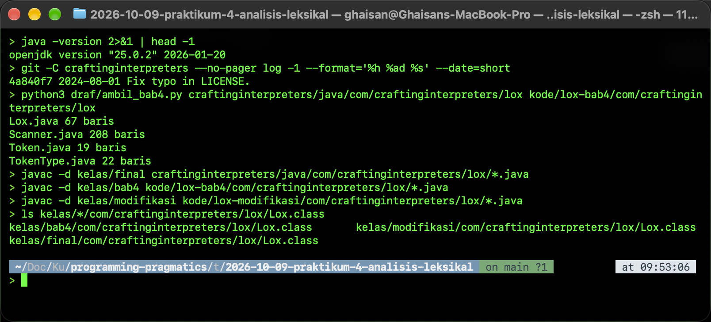
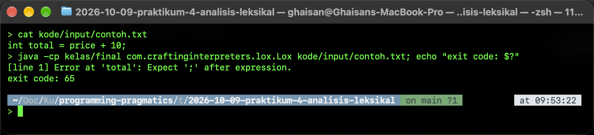
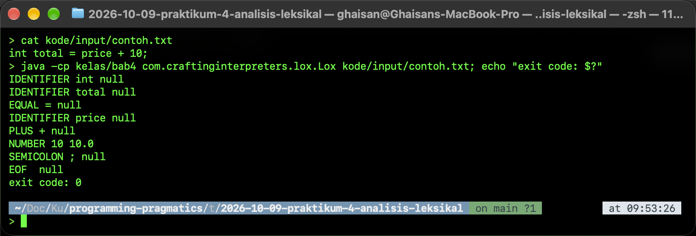
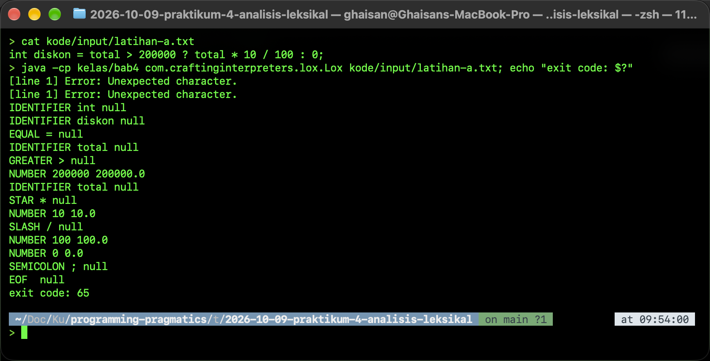
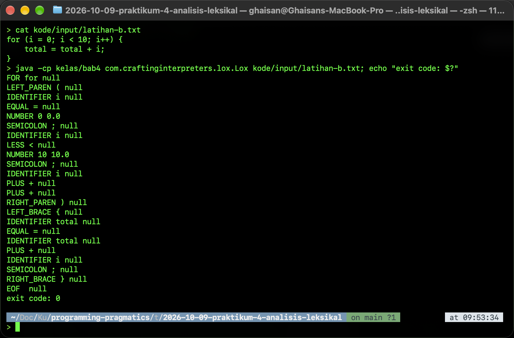
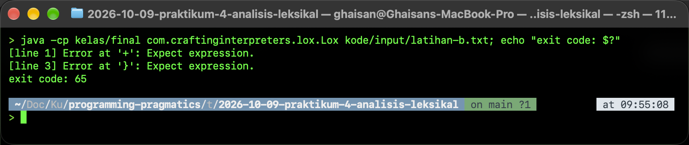
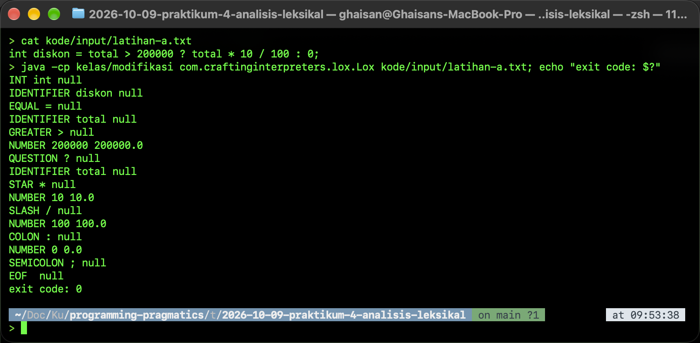
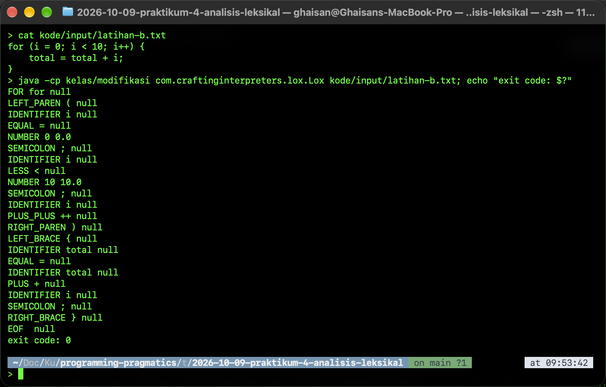

# Laporan Praktikum Pertemuan 4: Analisis Leksikal

Naskah sumber PDF `PLP_P4_TE_2B_048.pdf`. Dibuat jadi PDF dengan `python3 draf/rakit.py`.

## PENDAHULUAN

### 1.1 Latar Belakang

Pertemuan 4 membahas analisis leksikal, yaitu tahap pertama compiler atau interpreter. Pada tahap ini source code dibaca karakter demi karakter, karakter-karakter yang berurutan dikelompokkan menjadi lexeme, setiap lexeme dicocokkan dengan pola regular expression, lalu diubah menjadi token. Slide memakai contoh `int total = price + 10;` untuk menunjukkan proses tersebut, kemudian meminta menjalankan program scanner dari buku *Crafting Interpreters* karya Robert Nystrom dan mengerjakan latihan identifikasi token untuk dua potongan source code.

### 1.2 Tujuan

- Menentukan pola regular expression untuk setiap bagian `int total = price + 10;` dan menjelaskan kenapa karakter-karakter tertentu dikelompokkan menjadi satu lexeme.
- Menjalankan program scanner jlox dari repo buku untuk menghasilkan token.
- Mengidentifikasi token dua potongan source code latihan secara manual, menjalankan keduanya di scanner, lalu membandingkan kedua hasilnya.

### 1.3 Lingkungan dan Program yang Dipakai

Praktikum dikerjakan di macOS dengan OpenJDK 25.0.2 (`javac` dan `java`). Program scanner diambil dari repo GitHub munificent/craftinginterpreters, commit `4a840f7` tanggal 1 Agustus 2024. Ada tiga versi yang dikompilasi:

- `kelas/final`: kode di folder `java/` repo, termasuk `Lox.java` yang ditautkan di slide. Ini versi final jlox yang sudah memuat semua bab.
- `kelas/bab4`: versi akhir Bab 4 *Scanning*, yaitu versi yang mencetak token.
- `kelas/modifikasi`: versi Bab 4 yang diubah sedikit untuk BAB V.

Repo hanya menyimpan kode final. Kode per bab baru muncul di folder `gen/` kalau dibangkitkan dengan tool Dart milik repo. Namun setiap potongan kode di repo diberi penanda bab, misalnya `//> Parsing Expressions print-ast` sampai `//<`, sehingga versi Bab 4 bisa diambil dengan skrip kecil `draf/ambil_bab4.py` yang hanya menyisakan potongan bab *Scanning*. Hasilnya, `Scanner.java`, `Token.java`, dan `TokenType.java` sama persis dengan versi final karena ketiganya memang selesai di Bab 4. Yang berbeda hanya `Lox.java`.



## REGULAR EXPRESSION, LEXEME, DAN TOKEN

Bab ini menjawab pertanyaan di slide 2 sampai slide 6 untuk contoh `int total = price + 10;`.

### 2.1 Pola Regular Expression yang Diperlukan

Untuk mengenali semua bagian `int total = price + 10;` dibutuhkan lima pola token ditambah satu pola whitespace. Pola whitespace tidak menghasilkan token, tetapi tetap diperlukan supaya scanner tahu bagian mana yang harus dilewati.

Tabel 2.1: Pola regular expression untuk int total = price + 10;

| Bagian | Jenis token | Pola regex |
|---|---|---|
| `int` | Keyword | `int` |
| `total`, `price` | Identifier | `[a-zA-Z_][a-zA-Z0-9_]*` |
| `=` | Operator penugasan | `=` |
| `+` | Operator aritmatika | `\+` |
| `10` | Konstanta numerik | `[0-9]+` |
| `;` | Special character | `;` |
| spasi | Whitespace, dibuang | `[ \t\n]+` |

Lexeme `int` cocok dengan dua pola sekaligus, yaitu pola keyword dan pola identifier. Scanner memilih keyword karena dua aturan. Pertama, lexeme diambil sepanjang mungkin (longest match). Kedua, kalau dua pola cocok dengan panjang yang sama, pola keyword didahulukan. Karena itu `int` menjadi keyword, sedangkan `integer` tetap identifier karena pola identifier menghasilkan lexeme yang lebih panjang. Pola identifier di tabel jenis token slide 5 tertulis `[a-zA-20-9_]*`, yang kemungkinan maksudnya `[a-zA-Z0-9_]*` seperti di Tabel 2.1.

### 2.2 Pembentukan Lexeme

Scanner membaca karakter satu per satu dari kiri ke kanan. Sebuah lexeme dimulai dari karakter yang cocok dengan awal salah satu pola, lalu terus diperpanjang selama karakter berikutnya masih bisa melanjutkan pola yang sama. Lexeme berhenti ketika karakter berikutnya tidak bisa lagi melanjutkan pola, misalnya spasi atau karakter dari kelompok lain. Jadi karakter-karakter dikelompokkan menjadi satu lexeme karena mereka berurutan, tidak dipisah, dan bersama-sama cocok dengan satu pola yang sama.

Tabel 2.2: Pengelompokan karakter menjadi lexeme

| Lexeme | Karakter | Pola yang cocok | Berhenti karena |
|---|---|---|---|
| `int` | i, n, t | identifier/keyword | spasi setelah t |
| `total` | t, o, t, a, l | identifier | spasi setelah l |
| `=` | = | operator | spasi, jadi bukan `==` |
| `price` | p, r, i, c, e | identifier | spasi setelah e |
| `+` | + | operator | spasi |
| `10` | 1, 0 | numerik | `;` bukan digit |
| `;` | ; | special character | akhir source |

Prinsip ini disebut maximal munch. Tanpa prinsip ini, `total` bisa saja dipotong menjadi `to` dan `tal`, karena keduanya juga cocok dengan pola identifier. Spasi sendiri tidak masuk lexeme mana pun dan hanya berfungsi sebagai pemisah. Dari 23 karakter pada contoh, ada 18 karakter yang membentuk 7 lexeme, sedangkan 5 karakter sisanya adalah spasi.

### 2.3 Menentukan Pola Tiap Lexeme

Tabel 2.3: Lexeme dan pola regex untuk tabel di slide 4

| Lexeme | Pattern/Regex | Jenis token |
|---|---|---|
| `int` | `int` | Keyword |
| `total` | `[a-zA-Z_][a-zA-Z0-9_]*` | Identifier (id) |
| `=` | `=` | Operator penugasan (assign_op) |
| `price` | `[a-zA-Z_][a-zA-Z0-9_]*` | Identifier (id) |
| `+` | `\+` | Operator (op) |
| `10` | `[0-9]+` | Konstanta numerik (num) |
| `;` | `;` | Special character (special) |

### 2.4 Dari Lexeme ke Token

Token ditulis sebagai pasangan nama token dan nilai atribut, `<nama-token, atribut>`. Untuk keyword cukup ditulis nama tokennya saja, misalnya `<int>`, karena jenisnya sudah menjelaskan semuanya. Untuk identifier, atributnya adalah nama yang ditulis programmer, dan untuk konstanta atributnya adalah nilainya. Mengikuti format slide 6, contoh di atas menghasilkan 7 token:

```
<int> <id, total> <assign_op, => <id, price> <op, +> <num, 10> <special, ;>
```

## MENJALANKAN PROGRAM SCANNER

### 3.1 Lox.java yang Ditautkan di Slide

Langkah pertama adalah menjalankan `Lox.java` dari tautan di slide, yaitu versi final jlox, dengan masukan contoh dari slide 2.



Versi final tidak mencetak token. Setelah scanning, token langsung diteruskan ke parser, resolver, dan interpreter. Parser membaca `int` sebagai sebuah ekspresi lalu mengharapkan titik koma, sehingga muncul error `Expect ';' after expression.` di lexeme `total` dan program keluar dengan exit code 65. Jadi untuk melihat token, yang dipakai adalah versi akhir Bab 4.

### 3.2 Versi Akhir Bab 4

Di versi akhir Bab 4, method `run()` pada `Lox.java` hanya menjalankan scanner lalu mencetak setiap token. Format cetaknya berasal dari `Token.toString()`, yaitu jenis token, lexeme, dan nilai literal.

```
private static void run(String source) {
  Scanner scanner = new Scanner(source);
  List<Token> tokens = scanner.scanTokens();

  // For now, just print the tokens.
  for (Token token : tokens) {
    System.out.println(token);
  }
}
```

### 3.3 Hasil untuk Contoh Slide



Hasilnya 7 token ditambah `EOF`. Urutan dan pembagian lexemenya sama dengan hasil manual di subbab 2.4, tetapi ada tiga perbedaan. Pertama, `int` menjadi `IDENTIFIER`, bukan keyword, karena Lox bertipe dinamis dan mendeklarasikan variabel dengan `var`, sehingga tidak punya keyword `int`. Kedua, literal `10` disimpan sebagai `10.0` karena semua angka di Lox bertipe double. Ketiga, program memberi jenis token sendiri untuk setiap simbol, misalnya `EQUAL` dan `PLUS`, bukan kategori umum seperti `op`. Ini karena parser nanti perlu membedakan `+` dari `*`.

## LATIHAN IDENTIFIKASI TOKEN

### 4.1 Potongan a

```
int diskon = total > 200000 ? total * 10 / 100 : 0;
```

#### Tahap a: identifikasi di atas kertas

Identifikasi manual mengikuti aturan leksikal bahasa seperti C atau Java dan jenis token di slide 5.

Tabel 4.1: Identifikasi manual token potongan a

| No | Lexeme | Jenis token | Token |
|---|---|---|---|
| 1 | `int` | Keyword | `<int>` |
| 2 | `diskon` | Identifier | `<id, diskon>` |
| 3 | `=` | Operator penugasan | `<assign_op, =>` |
| 4 | `total` | Identifier | `<id, total>` |
| 5 | `>` | Operator relasional | `<op, >>` |
| 6 | `200000` | Konstanta numerik | `<num, 200000>` |
| 7 | `?` | Operator kondisional | `<op, ?>` |
| 8 | `total` | Identifier | `<id, total>` |
| 9 | `*` | Operator aritmatika | `<op, *>` |
| 10 | `10` | Konstanta numerik | `<num, 10>` |
| 11 | `/` | Operator aritmatika | `<op, />` |
| 12 | `100` | Konstanta numerik | `<num, 100>` |
| 13 | `:` | Operator kondisional | `<op, :>` |
| 14 | `0` | Konstanta numerik | `<num, 0>` |
| 15 | `;` | Special character | `<special, ;>` |

Hasilnya 15 token. Lexeme `?` dan `:` dicatat sebagai operator karena di potongan ini keduanya membentuk operator kondisional `kondisi ? nilai1 : nilai2`. Di tabel slide 5, `:` masuk special character karena di tempat lain dipakai sebagai pemisah, misalnya pada `case 1:`. Ini contoh bahwa jenis token kadang bergantung pada aturan bahasa, bukan hanya pada bentuk karakternya.

#### Tahap b: hasil program



### 4.2 Potongan b

```
for (i = 0; i < 10; i++) {
    total = total + i;
}
```

#### Tahap a: identifikasi di atas kertas

Tabel 4.2: Identifikasi manual token potongan b

| No | Lexeme | Jenis token | Token |
|---|---|---|---|
| 1 | `for` | Keyword | `<for>` |
| 2 | `(` | Special character | `<special, (>` |
| 3 | `i` | Identifier | `<id, i>` |
| 4 | `=` | Operator penugasan | `<assign_op, =>` |
| 5 | `0` | Konstanta numerik | `<num, 0>` |
| 6 | `;` | Special character | `<special, ;>` |
| 7 | `i` | Identifier | `<id, i>` |
| 8 | `<` | Operator relasional | `<op, <>` |
| 9 | `10` | Konstanta numerik | `<num, 10>` |
| 10 | `;` | Special character | `<special, ;>` |
| 11 | `i` | Identifier | `<id, i>` |
| 12 | `++` | Operator increment | `<op, ++>` |
| 13 | `)` | Special character | `<special, )>` |
| 14 | `{` | Special character | `<special, {>` |
| 15 | `total` | Identifier | `<id, total>` |
| 16 | `=` | Operator penugasan | `<assign_op, =>` |
| 17 | `total` | Identifier | `<id, total>` |
| 18 | `+` | Operator aritmatika | `<op, +>` |
| 19 | `i` | Identifier | `<id, i>` |
| 20 | `;` | Special character | `<special, ;>` |
| 21 | `}` | Special character | `<special, }>` |

Hasilnya 21 token. Newline dan spasi indentasi di baris kedua tidak menjadi token. Lexeme `++` dihitung sebagai satu token karena maximal munch: setelah membaca `+` pertama, scanner melihat `+` berikutnya masih bisa membentuk operator yang lebih panjang.

#### Tahap b: hasil program



### 4.3 Perbandingan Hasil Manual dan Program

Tabel 4.3: Perbandingan hasil manual dan program untuk potongan a

| Lexeme | Manual | Program | Keterangan |
|---|---|---|---|
| `int` | `<int>` | `IDENTIFIER int` | Lox tidak punya keyword `int` |
| `?` | `<op, ?>` | error `Unexpected character.` | Lox tidak punya operator kondisional |
| `:` | `<op, :>` | error `Unexpected character.` | sama seperti `?` |
| `200000`, `10`, `100`, `0` | `<num, 200000>` dan seterusnya | `NUMBER 200000 200000.0` dan seterusnya | sama, tetapi literal Lox selalu double |
| `diskon`, `total` | `<id, ...>` | `IDENTIFIER` | sama |
| `=`, `>`, `*`, `/` | `assign_op` dan `op` | `EQUAL`, `GREATER`, `STAR`, `SLASH` | sama, program lebih rinci |
| `;` | `<special, ;>` | `SEMICOLON` | sama |
| akhir source | tidak ada | `EOF` | program menambah penanda akhir |

Tabel 4.4: Perbandingan hasil manual dan program untuk potongan b

| Lexeme | Manual | Program | Keterangan |
|---|---|---|---|
| `for` | `<for>` | `FOR for` | sama, `for` juga keyword Lox |
| `++` | `<op, ++>`, satu token | `PLUS +` dua kali | Lox tidak punya operator `++` |
| `0`, `10` | `<num, 0>`, `<num, 10>` | `NUMBER 0 0.0`, `NUMBER 10 10.0` | sama, literal double |
| `(`, `)`, `{`, `}` | `<special, ...>` | `LEFT_PAREN`, `RIGHT_PAREN`, `LEFT_BRACE`, `RIGHT_BRACE` | sama |
| `i`, `total`, `=`, `<`, `+`, `;` | `id`, `assign_op`, `op`, `special` | `IDENTIFIER`, `EQUAL`, `LESS`, `PLUS`, `SEMICOLON` | sama |
| newline dan indentasi | dibuang | dibuang, hanya menambah nomor baris | sama |
| akhir source | tidak ada | `EOF` | program menambah penanda akhir |

Untuk potongan a, hasil manual berisi 15 token, sedangkan program menghasilkan 13 token ditambah `EOF` dan dua error, lalu keluar dengan exit code 65. Untuk potongan b, hasil manual berisi 21 token, sedangkan program menghasilkan 22 token ditambah `EOF` tanpa error, dengan exit code 0.

Perbedaan ini bukan karena scanner salah, tetapi karena aturan leksikal yang dipakai berbeda. Identifikasi manual memakai aturan bahasa seperti C atau Java, sedangkan scanner jlox memakai aturan bahasa Lox. Perbedaannya ada dua macam:

- **Karakter yang sama sekali tidak dikenal**, yaitu `?` dan `:`. Scanner melaporkan `Unexpected character.` beserta nomor barisnya, tetapi tetap melanjutkan pemindaian. Karakter yang salah sudah dikonsumsi oleh `advance()`, jadi scanner tidak terjebak, dan sisa token tetap keluar. Flag `hadError` membuat program keluar dengan kode 65.
- **Karakter yang dikenal tetapi dipecah atau diberi jenis lain**, yaitu `int` yang menjadi `IDENTIFIER` dan `++` yang menjadi dua `PLUS`. Di sini scanner tidak melaporkan error sama sekali, karena setiap bagiannya memang lexeme yang sah di Lox. Kesalahannya baru ketahuan di tahap berikutnya. Kalau potongan b dijalankan dengan Lox versi final, parser yang menolaknya. Setelah `i +`, parser mengharapkan ekspresi, padahal yang datang `+` lagi, dan Lox tidak punya operator unary `+`.



## MODIFIKASI SCANNER

Untuk membuktikan bahwa perbedaan di BAB IV berasal dari aturan leksikal, scanner Bab 4 diubah sedikit supaya mengenali empat hal yang tidak ada di Lox: `?`, `:`, `++`, dan keyword `int`. Di `TokenType.java` ditambahkan jenis token `QUESTION`, `COLON`, `PLUS_PLUS`, dan `INT`. Di `Scanner.java` ada empat baris yang ditambah atau diubah:

```
keywords.put("int",    INT);    // modifikasi

case '+': addToken(match('+') ? PLUS_PLUS : PLUS); break; // modifikasi
case '?': addToken(QUESTION); break;                     // modifikasi
case ':': addToken(COLON); break;                        // modifikasi
```

Perubahan `+` memakai teknik yang sama dengan operator dua karakter lain di Lox, seperti `!=` dan `<=`. Fungsi `match('+')` mengintip karakter berikutnya, lalu mengonsumsinya hanya kalau karakternya `+`.





Setelah modifikasi, potongan a menghasilkan 15 token dan potongan b 21 token, masing-masing ditambah `EOF` dan tanpa error. Urutan dan jenisnya sama dengan hasil manual di Tabel 4.1 dan Tabel 4.2. Perbedaan yang tersisa hanya nama jenis token yang lebih rinci dan literal angka yang disimpan sebagai double. Modifikasi ini hanya menyentuh scanner. Parser Lox tetap tidak mengerti `int` atau operator kondisional, jadi potongan tersebut masih belum bisa dijalankan sebagai program Lox.

## KESIMPULAN

1. Lexeme terbentuk dari karakter berurutan yang bersama-sama cocok dengan satu pola dan diambil sepanjang mungkin (maximal munch). Whitespace hanya menjadi pemisah dan tidak masuk lexeme mana pun.

2. Setiap jenis token bisa dijelaskan dengan regular expression. Keyword juga cocok dengan pola identifier, jadi scanner membutuhkan aturan prioritas atau tabel keyword. Scanner jlox memakai tabel keyword dalam bentuk hash map.

3. Hasil identifikasi manual dan hasil program berbeda pada `int`, `?`, `:`, `++`, dan bentuk literal angka. Penyebabnya, manual memakai aturan leksikal C/Java, sedangkan scanner jlox memakai aturan Lox. Karakter yang tidak dikenal menghasilkan error tanpa menghentikan scanning, sedangkan lexeme yang dikenal tetapi berbeda arti baru ketahuan di parser.

4. Setelah empat aturan ditambahkan ke scanner, hasil program sama dengan hasil manual. Jadi token yang dihasilkan dari sebuah source code bergantung pada definisi leksikal bahasanya, bukan hanya pada teks source code itu sendiri.
