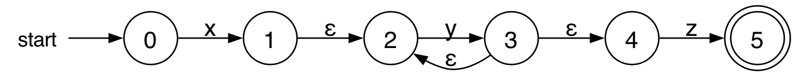
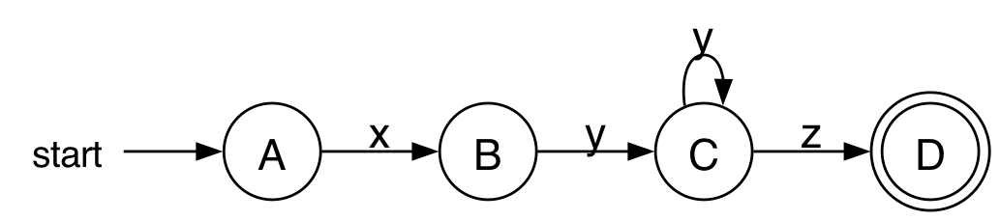
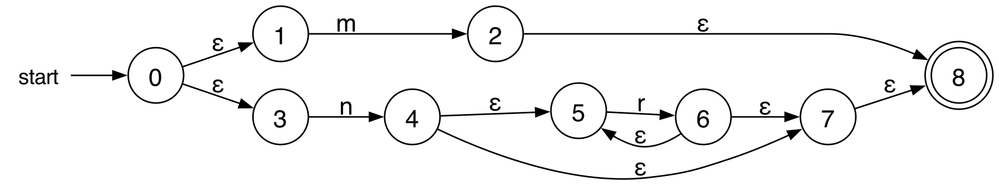
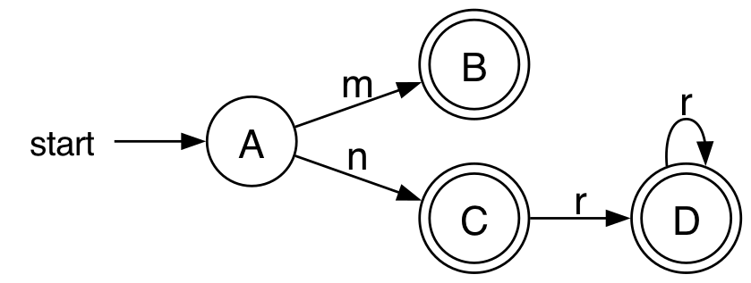
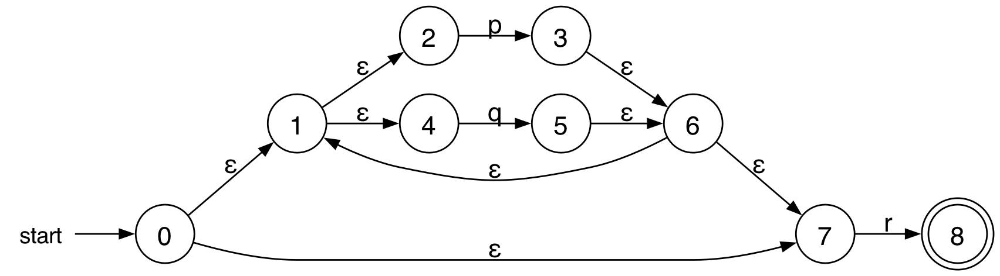
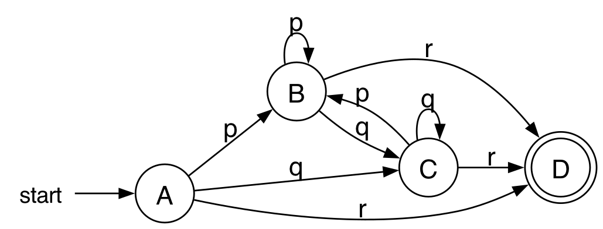
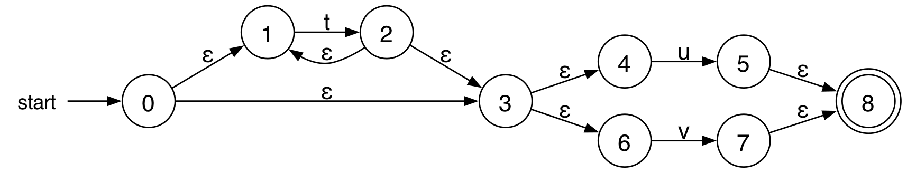
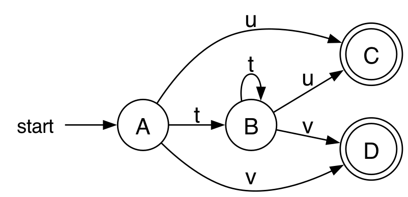
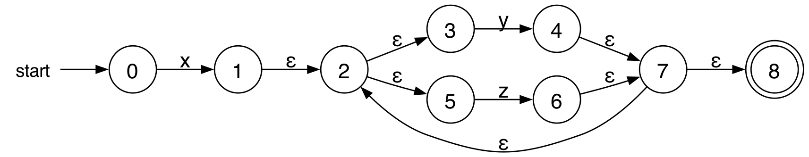
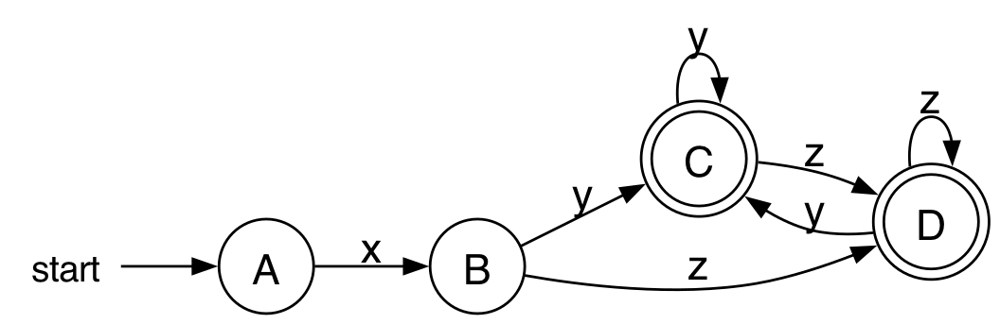

# Regex ke NFA dan NFA ke DFA

Naskah sumber PDF, dibuat oleh `draf/fa.py`. Jangan diedit manual, ubah fa.py lalu jalankan ulang.

## PENDAHULUAN

### 1.1 Soal

Lima regular expression dari Latihan 1 pertemuan 3 dicari contoh string-nya, lalu diubah menjadi NFA, kemudian NFA tersebut diubah menjadi DFA:

- P → `x(y)+z`, alfabet {x, y, z}
- Q → `m | nr*`, alfabet {m, n, r}
- R → `(p | q)*r`, alfabet {p, q, r}
- T → `t*(u | v)`, alfabet {t, u, v}
- W → `x(y | z)+`, alfabet {x, y, z}

### 1.2 Latihan 1: String yang Dihasilkan

- P = {xyz, xyyz, xyyyz, ...}
- Q = {m, n, nr, nrr, ...}
- R = {r, pr, qr, pqr, ...}
- T = {u, v, tu, tv, ...}
- W = {xy, xz, xyz, xzy, ...}

### 1.3 Cara Pengerjaan

- Regex ke NFA memakai aturan di slide *RegEx to NFA*: NFA untuk simbol, concatenation (state akhir N(s) digabung dengan state awal N(t)), union, Kleene closure, dan positive closure. Penomoran state mengikuti contoh (a|b)*abb di slide, dari kiri ke kanan dan cabang atas lebih dulu.
- NFA ke DFA memakai *ε-closure* dan *move* seperti di slide *Conversion of an NFA to a DFA*. Kalau hasil *move* sudah pernah dihitung, *ε-closure*-nya tidak ditulis ulang.
- ∅ berarti tidak ada transisi. Pada DFA, ∅ adalah dead state yang tidak digambar di diagram.
- Semua NFA dan DFA dicek dengan program: untuk setiap string sampai panjang 6 atas alfabetnya, NFA dan DFA menerima string yang sama persis dengan regex aslinya.

## P → `x(y)+z`

### 2.1 Regex ke NFA

Tabel 2.1: Tabel transisi NFA P

| State | x | y | z | ε |
|---|---|---|---|---|
| 0 | {1} | ∅ | ∅ | ∅ |
| 1 | ∅ | ∅ | ∅ | {2} |
| 2 | ∅ | {3} | ∅ | ∅ |
| 3 | ∅ | ∅ | ∅ | {2, 4} |
| 4 | ∅ | ∅ | {5} | ∅ |
| 5 | ∅ | ∅ | ∅ | ∅ |

State awal 0, state final 5.

### 2.2 NFA ke DFA

- *ε-closure* (0) = {0} → **A**
- *move* [A, x] = {1}
- *ε-closure* ([A, x]) = *ε-closure* ({1}) = {1, 2} → **B**
- *move* [A, y] = *move* [A, z] = ∅
- *move* [B, y] = {3}
- *ε-closure* ([B, y]) = *ε-closure* ({3}) = {2, 3, 4} → **C**
- *move* [B, x] = *move* [B, z] = ∅
- *move* [C, y] = {3} → **C**
- *move* [C, z] = {5}
- *ε-closure* ([C, z]) = *ε-closure* ({5}) = {5} → **D**
- *move* [C, x] = ∅
- *move* [D, x] = *move* [D, y] = *move* [D, z] = ∅

Tabel 2.2: Tabel transisi DFA P

| State NFA | State DFA | x | y | z |
|---|---|---|---|---|
| {0} | A | B | ∅ | ∅ |
| {1, 2} | B | ∅ | C | ∅ |
| {2, 3, 4} | C | ∅ | C | D |
| {5} | **D** | ∅ | ∅ | ∅ |

State awal A, state final D (dicetak tebal) karena memuat state final NFA 5.

## Q → `m | nr*`

### 3.1 Regex ke NFA

Tabel 3.1: Tabel transisi NFA Q

| State | m | n | r | ε |
|---|---|---|---|---|
| 0 | ∅ | ∅ | ∅ | {1, 3} |
| 1 | {2} | ∅ | ∅ | ∅ |
| 2 | ∅ | ∅ | ∅ | {8} |
| 3 | ∅ | {4} | ∅ | ∅ |
| 4 | ∅ | ∅ | ∅ | {5, 7} |
| 5 | ∅ | ∅ | {6} | ∅ |
| 6 | ∅ | ∅ | ∅ | {5, 7} |
| 7 | ∅ | ∅ | ∅ | {8} |
| 8 | ∅ | ∅ | ∅ | ∅ |

State awal 0, state final 8.

### 3.2 NFA ke DFA

- *ε-closure* (0) = {0, 1, 3} → **A**
- *move* [A, m] = {2}
- *ε-closure* ([A, m]) = *ε-closure* ({2}) = {2, 8} → **B**
- *move* [A, n] = {4}
- *ε-closure* ([A, n]) = *ε-closure* ({4}) = {4, 5, 7, 8} → **C**
- *move* [A, r] = ∅
- *move* [B, m] = *move* [B, n] = *move* [B, r] = ∅
- *move* [C, r] = {6}
- *ε-closure* ([C, r]) = *ε-closure* ({6}) = {5, 6, 7, 8} → **D**
- *move* [C, m] = *move* [C, n] = ∅
- *move* [D, r] = {6} → **D**
- *move* [D, m] = *move* [D, n] = ∅

Tabel 3.2: Tabel transisi DFA Q

| State NFA | State DFA | m | n | r |
|---|---|---|---|---|
| {0, 1, 3} | A | B | C | ∅ |
| {2, 8} | **B** | ∅ | ∅ | ∅ |
| {4, 5, 7, 8} | **C** | ∅ | ∅ | D |
| {5, 6, 7, 8} | **D** | ∅ | ∅ | D |

State awal A, state final B, C, D (dicetak tebal) karena memuat state final NFA 8.

## R → `(p | q)*r`

### 4.1 Regex ke NFA

Tabel 4.1: Tabel transisi NFA R

| State | p | q | r | ε |
|---|---|---|---|---|
| 0 | ∅ | ∅ | ∅ | {1, 7} |
| 1 | ∅ | ∅ | ∅ | {2, 4} |
| 2 | {3} | ∅ | ∅ | ∅ |
| 3 | ∅ | ∅ | ∅ | {6} |
| 4 | ∅ | {5} | ∅ | ∅ |
| 5 | ∅ | ∅ | ∅ | {6} |
| 6 | ∅ | ∅ | ∅ | {1, 7} |
| 7 | ∅ | ∅ | {8} | ∅ |
| 8 | ∅ | ∅ | ∅ | ∅ |

State awal 0, state final 8.

### 4.2 NFA ke DFA

- *ε-closure* (0) = {0, 1, 2, 4, 7} → **A**
- *move* [A, p] = {3}
- *ε-closure* ([A, p]) = *ε-closure* ({3}) = {1, 2, 3, 4, 6, 7} → **B**
- *move* [A, q] = {5}
- *ε-closure* ([A, q]) = *ε-closure* ({5}) = {1, 2, 4, 5, 6, 7} → **C**
- *move* [A, r] = {8}
- *ε-closure* ([A, r]) = *ε-closure* ({8}) = {8} → **D**
- *move* [B, p] = {3} → **B**
- *move* [B, q] = {5} → **C**
- *move* [B, r] = {8} → **D**
- *move* [C, p] = {3} → **B**
- *move* [C, q] = {5} → **C**
- *move* [C, r] = {8} → **D**
- *move* [D, p] = *move* [D, q] = *move* [D, r] = ∅

Tabel 4.2: Tabel transisi DFA R

| State NFA | State DFA | p | q | r |
|---|---|---|---|---|
| {0, 1, 2, 4, 7} | A | B | C | D |
| {1, 2, 3, 4, 6, 7} | B | B | C | D |
| {1, 2, 4, 5, 6, 7} | C | B | C | D |
| {8} | **D** | ∅ | ∅ | ∅ |

State awal A, state final D (dicetak tebal) karena memuat state final NFA 8.

## T → `t*(u | v)`

### 5.1 Regex ke NFA

Tabel 5.1: Tabel transisi NFA T

| State | t | u | v | ε |
|---|---|---|---|---|
| 0 | ∅ | ∅ | ∅ | {1, 3} |
| 1 | {2} | ∅ | ∅ | ∅ |
| 2 | ∅ | ∅ | ∅ | {1, 3} |
| 3 | ∅ | ∅ | ∅ | {4, 6} |
| 4 | ∅ | {5} | ∅ | ∅ |
| 5 | ∅ | ∅ | ∅ | {8} |
| 6 | ∅ | ∅ | {7} | ∅ |
| 7 | ∅ | ∅ | ∅ | {8} |
| 8 | ∅ | ∅ | ∅ | ∅ |

State awal 0, state final 8.

### 5.2 NFA ke DFA

- *ε-closure* (0) = {0, 1, 3, 4, 6} → **A**
- *move* [A, t] = {2}
- *ε-closure* ([A, t]) = *ε-closure* ({2}) = {1, 2, 3, 4, 6} → **B**
- *move* [A, u] = {5}
- *ε-closure* ([A, u]) = *ε-closure* ({5}) = {5, 8} → **C**
- *move* [A, v] = {7}
- *ε-closure* ([A, v]) = *ε-closure* ({7}) = {7, 8} → **D**
- *move* [B, t] = {2} → **B**
- *move* [B, u] = {5} → **C**
- *move* [B, v] = {7} → **D**
- *move* [C, t] = *move* [C, u] = *move* [C, v] = ∅
- *move* [D, t] = *move* [D, u] = *move* [D, v] = ∅

Tabel 5.2: Tabel transisi DFA T

| State NFA | State DFA | t | u | v |
|---|---|---|---|---|
| {0, 1, 3, 4, 6} | A | B | C | D |
| {1, 2, 3, 4, 6} | B | B | C | D |
| {5, 8} | **C** | ∅ | ∅ | ∅ |
| {7, 8} | **D** | ∅ | ∅ | ∅ |

State awal A, state final C, D (dicetak tebal) karena memuat state final NFA 8.

## W → `x(y | z)+`

### 6.1 Regex ke NFA

Tabel 6.1: Tabel transisi NFA W

| State | x | y | z | ε |
|---|---|---|---|---|
| 0 | {1} | ∅ | ∅ | ∅ |
| 1 | ∅ | ∅ | ∅ | {2} |
| 2 | ∅ | ∅ | ∅ | {3, 5} |
| 3 | ∅ | {4} | ∅ | ∅ |
| 4 | ∅ | ∅ | ∅ | {7} |
| 5 | ∅ | ∅ | {6} | ∅ |
| 6 | ∅ | ∅ | ∅ | {7} |
| 7 | ∅ | ∅ | ∅ | {2, 8} |
| 8 | ∅ | ∅ | ∅ | ∅ |

State awal 0, state final 8.

### 6.2 NFA ke DFA

- *ε-closure* (0) = {0} → **A**
- *move* [A, x] = {1}
- *ε-closure* ([A, x]) = *ε-closure* ({1}) = {1, 2, 3, 5} → **B**
- *move* [A, y] = *move* [A, z] = ∅
- *move* [B, y] = {4}
- *ε-closure* ([B, y]) = *ε-closure* ({4}) = {2, 3, 4, 5, 7, 8} → **C**
- *move* [B, z] = {6}
- *ε-closure* ([B, z]) = *ε-closure* ({6}) = {2, 3, 5, 6, 7, 8} → **D**
- *move* [B, x] = ∅
- *move* [C, y] = {4} → **C**
- *move* [C, z] = {6} → **D**
- *move* [C, x] = ∅
- *move* [D, y] = {4} → **C**
- *move* [D, z] = {6} → **D**
- *move* [D, x] = ∅

Tabel 6.2: Tabel transisi DFA W

| State NFA | State DFA | x | y | z |
|---|---|---|---|---|
| {0} | A | B | ∅ | ∅ |
| {1, 2, 3, 5} | B | ∅ | C | D |
| {2, 3, 4, 5, 7, 8} | **C** | ∅ | C | D |
| {2, 3, 5, 6, 7, 8} | **D** | ∅ | C | D |

State awal A, state final C, D (dicetak tebal) karena memuat state final NFA 8.

## RINGKASAN

Tabel 7.1: Ringkasan hasil konversi

| Nama | Regex | State NFA | State DFA | State final DFA |
|---|---|---|---|---|
| P | `x(y)+z` | 6 | 4 | D |
| Q | `m \| nr*` | 9 | 4 | B, C, D |
| R | `(p \| q)*r` | 9 | 4 | D |
| T | `t*(u \| v)` | 9 | 4 | C, D |
| W | `x(y \| z)+` | 9 | 4 | C, D |
